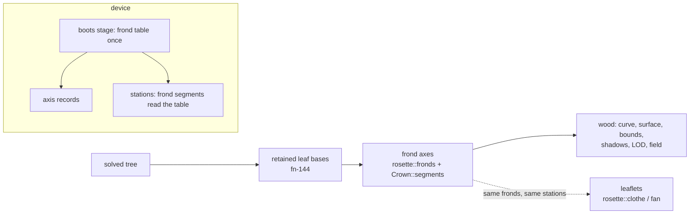

# A frond draws its rachis

## Goal & Context

Release item (owner, 2026-10-19: "option 3", pulling it into 0.2.0 ahead of the film; it was first scheduled after the release by the host on 2026-10-15, from fn-275 R2c). The owner, viewing the young date palm: "it looks nice other than having the leaves not being connected in a sensible way". For the release fn-275 crowds a young frond's segments toward its base; this spec draws the rachis itself.

The film made it visible again (fn-272 cut 4, 2026-10-19). The owner: "As we transition to the palm tree there's some flying leaves that don't make sense." The film agent measured why (fn-272 FILM.md; probe `crates/telperion-render/examples/frond_probe.rs` on the film branch): a frond is placement only, with no node and no wood (`pipeline/foliage/rosette.rs`, `fronds`/`clothe`; `pipeline/foliage/leaflet.rs`, `rachis`/`leaflets`). On the palm at 40 the 111 leaflets along a 6.98 m rachis sit 0.05 of a leaf length from their neighbours, so the frond reads although its median leaflet stands 1.29 m from any drawn wood. On the oak-to-palm walk the rachis length and frond count walk linearly while the leaflet count walks on fn-277's log scale, so at t = 0.5125 a 3.59 m rachis carries 11.3 leaflets, one per 0.32 m, and 203 of 351 leaves stand more than 0.5 m from any drawn wood: the halo runs from walk t = 0.067 to 0.562.

Who it affects: the owner's verdict on the palm and the release film; every consumer of the drawn wood (renderer, field, wasm entries), since the rachis is wood they all draw. No other preset changes: the row is dormant at zero.

## Architecture & Data Models

The axis is wood hung in the expansion's first step, the one every solved tree passes (`pipeline::clothe`, grown or handed in), beside the retained leaf bases and after the radius solve, so it never enters the pipe model and never thickens the trunk.



- **One frond, one axis.** For every frond `rosette::fronds` yields (living and skirt), a run of its own: a first node at the frond's insertion `frond.at` on the stem's axis, parented to the stem node that depth falls on (the rule a retained base leaves the axis by), then one node at each leaflet station `t_k` that `leaflet::leaflets` places a leaflet or spine at, on `leaflet::rachis`. So the leaflets and the axis read one path (R2), a young frond's axis ends at its last segment's base (`Split::segment`), a mature frond's at `t = 1`, and every leaflet and spine base is a node of the axis (R6). Node kind is the leaf bases' (wood, `stem: false`), so no foliage clothes it.
- **Continuity with the leaf base (R1).** The axis leaves the stem by the same rule a retained base does (its own run, its first node on the axis at its insertion depth, socket and swell by the surface builder); a retained base is what the same spiral keeps below the crown once the frond is shed. Nothing joins the living crown's axes to the lattice's boots geometrically: they stand on different heights of one spiral (the bases begin where the oldest living frond leaves the axis, `leaf_bases.rs`).
- **Radius (R3).** `r(t) = max(r0 · (1 − t), FINEST)` at rachis share `t`, with `r0 = rachisWidth / 2 · s` and `s` the frond's size share (`frond.canopy.rachis_length / p.rachis_length`: unfolding, establishment, the skirt's length and its fade). A function of `t` alone, so a young frond's axis ends thicker where it stops short and the same station has the same girth at every age. FINEST is the engine's thinnest drawn wood (`space.rs`, 0.2 mm).
- **Dormancy (R3).** No axis where `rachisWidth` is zero, where a frond carries one leaflet (its lone blade stands at `frond.at`, on the stem), or where its rachis has no length (all its leaflets stand at `frond.at`). Each test is per frond, on the whole counts the frond draws (`frond_leaflets`), so a fractional `leafletCount` dorms some fronds and not others by the same draw the leaves take.
- **One clothing step.** The bases and the axes are appended as one tail and recognised as one tail, so a tree handed back clothed is not clothed twice (`clothed` in `leaf_bases.rs` today checks only the bases' tail).
- **The leaf box takes the axes (R1).** The axes are wood, and the leaf box (`Reference::grown`, `Reach::wood_box`, the device's `fold.wgsl` crowns) reaches round every wood node; on the palm the axes widen it, so the palm's leaf instances move by the float32 quantisation of the wider box and no more. The box is not special-cased to keep the palm's leaf bytes: the owner's generator-evolution rule (AGENTS.md, 2026-09-20) allows the byte change, and a second box rule for axes would be a route around the one wood. Every other preset's box and bytes are unchanged (no axis).
- **Device (R4).** The frond clock and the segment draw (`unfolded_frond`, `born_frond`, `established_frond`, `pinnate_frond`, `frond_leaves`, `segments`, the spiral in `rosette()`) move from `stations.wgsl` to the boots stage, run once per apex into a frond table that the axis records and the stations' frond segments both read. The dress's room for the boots grows by the most axis records a stem can hang. The table's inputs that today reach only the stations stage move earlier with it: the requested year (`build::placed` passes it to `station_rows`; the boots chain `readied → folded → Hanger::hang` gets none today) and the blade (`crown::blade` of the element, which is built from the family's element rows alone, so it can be built before the folds). Every build that runs the boots stage (mature, growing, field, fractional year) passes the year it draws.

## Acceptance Criteria

The owner's and the host's requirements, kept as written; the errors and boundaries each carries follow it.

- **R1:** a frond's leaf base, petiole and rachis are one woody axis, continuous with the retained leaf base (fn-144), hung as wood beside the leaf bases and drawn by the existing surface builder, bounds, shadows, level of detail and device path. No second renderer path. Errors: a tree whose axes would pass the node rail is refused by name (`ResourceLimit`), never truncated; a tree already clothed is not clothed again.
- **R2:** one source of truth for the path: the leaflets and the axis follow the same arch (`rachisLength`, `rachisArch`), and on a young frond the axis ends at the last segment's base. Errors: no error surface beyond the existing rosette rows' refusals.
- **R3:** one new row, the rachis base width, 0.25 m for the date palm (FAO 156 ch. I, lines 230–232), scaled by the frond's size share, tapering, never below FINEST; zero is dormant, and it is dormant without leaflet grouping. Errors: a width outside its bounds (0 to 10 m, the rosette site's other metre rows' rail) or not finite is refused by its own name, as `every_new_row_is_refused_by_its_own_name` holds the rosette rows; every preset with the row at zero builds byte-identical to the base.
- **R4:** on the device the frond clock and segment draw move to the earliest stage that needs them (the leaf-base stage), computed once; the worker's estimate was about 1,200 lines (fn-275's friction, now summarized in its spec; 904a17ba7). Errors: a device capacity failure is a named error, never a CPU rebuild; the device's leaves are unchanged by the move (equivalence pinned before the axis records land).
- **R5:** CPU = device; the palm at 40 under 0.5 s warm; stills viewed; the owner's verdict. A leaf-coloured axis material is a later item. Errors: no error surface; the timing is the device's warm build (`build_time`, ignored measurement) on the owner's machine, base and branch both measured.
- **R6 (host, 2026-10-15, from fn-275 R2c):** the spines leave gaps without a drawn rachis: a leaflet next to a basal spine sits 1.0 to 1.88 widths from any other segment on young fronds, the spines 1.9 to 3.2 from f 0.57, and the mature frond 1.39 (fn-275 SEEDLING.md). With the rachis drawn, every leaflet and spine base lies on it. Errors: measured on the drawn curve, not on the nodes.
- **R7 (owner, 2026-10-19, from fn-272 cut 4):** the walk shows it too. On the film's oak-to-palm walk at age 40 (seed 7), every leaflet base lies on drawn wood at every walk share, measured by the probe's distance from each leaflet base to the nearest drawn wood, across t = 0 to 1; the stills at t = 0.5 and 1 are viewed. The fix is the drawn rachis, not a change to how the walk blends the frond's rows (fn-277's log scale stays). Scope (host, 2026-10-19): R7 binds the frond's leaflets and spines. The station-borne compound leaves the walk also shows (Open questions) are a second design and their own spec; the owner's verdict on the re-rendered film decides whether that spec joins the release.

"Lies on drawn wood" is measured as the probe measures it, against the drawn curve (`tree.curve`, each point's sphere, and between the points of one run its tapered capsule): a base is on the wood when that distance is under 1 mm.

## Early proof point

Task fn-283-a-frond-draws-its-rachis.1 validates the core approach (one node per leaflet station puts every frond leaflet and spine base on the drawn curve of the palm at 40 and the young palm, with every other preset byte-identical). If it fails, re-evaluate how the axis is sampled (a node per station against the surface builder's smoothing) before continuing with fn-283-a-frond-draws-its-rachis.2+.

## Boundaries

- A leaf-coloured axis material (R5: later); the axis takes the bark material.
- No change to how the walk blends the frond's rows (R7; fn-277's log scale stays).
- Station-borne and cluster-borne compound leaves (`station.rs`, `cluster.rs` through `rosette::fan`) get no axis here; see Open questions.
- No change to the retained leaf bases' geometry or the lattice.
- The growth path (`?growth=1`) clothes through the same step and takes the axes with it; its pins are refreshed, never made a gate.

## Strategy Alignment

Active tracks served by this plan:
- **The catalogue** — the date palm's frond reads as one organ, the owner's open note on the young palm.
- **Surface and rendering at scale** — the frond's structure becomes legible wood through the one surface builder, with no frond-specific path.

## Decision Context

- A node at every leaflet station, rather than a fixed sample of the arch: the leaflets' bases must lie on the drawn wood at a radius that tapers to 0.2 mm, which a chord between sparse samples cannot hold (the arch's sagitta over a 7 m rachis at `rachisArch` −0.6 is about 1 mm at a 1/33 spacing). Its cost is measured under R5.
- Width scales with the frond's size share, not with its leaflet grouping's degree: R3 states it; the grouping's dormancy is per frond, by the whole count it draws.
- The spec's forward edge on fn-144 (open, its one task done) is not added: its code is on this branch, and an edge to an open spec would hold this release item.

## Open questions

- **Station-borne compound leaves on the walk (R7 scope; host).** Measured on the base (`raw/walk-probe2.tsv`, scratch probe of the film's measure split by source): mid-walk the oak's cauline share still clothes twig stations, and those placements fan into compound leaves on undrawn rachises too. At t = 0.1, 0.2 and 0.3 they number 1,445, 87 and 56 leaves, of which 38, 17 and 28 stand over 0.5 m from wood (median 0.12, 0.25 and 0.51 m); from t = 0.4 none remain. R1 draws a frond's axis; R7 asks every leaflet base on wood. Drawing an axis for every station placement is a second design (stations are placed after the wood is drawn, on its swept surface). The plan builds the frond's axis, which every answer needs, and reports R7 split by source. Ruled (host, 2026-10-19): R7 is narrowed to the frond's leaflets and spines, and no axis is drawn here for station placements. The reason: the halo the owner saw is the frond's (203 of 351 leaves at t = 0.5125, t = 0.067 to 0.562), while the station leaves stand closer (median 0.12 to 0.51 m) and only to t = 0.3; drawing them an axis is a different stage (placed on the swept surface after the wood). Task .4 still reports the station leaves' distances, so the owner judges them in the re-rendered film.

## Quick commands

```bash
cargo test --profile ci -p telperion-core rachis
cargo test --profile ci -p telperion-core rosette
BUILD_PRESETS=date-palm BUILD_AGE=40 cargo test --profile ci -p telperion-render build_time -- --ignored --nocapture
```

## Requirement coverage

| Req | Description | Task(s) | Gap justification |
| --- | --- | --- | --- |
| R1 | a frond's leaf base, petiole and rachis are one woody axis, continuous with the retained leaf base (fn-144), hung as wood beside the leaf bases and drawn by the existing surface builder, bounds, shadows, level of detail and device path. No second renderer path. Errors: a tree whose axes would pass the node rail is refused by name (`ResourceLimit`), never truncated; a tree already clothed is not clothed again. | fn-283-a-frond-draws-its-rachis.1, fn-283-a-frond-draws-its-rachis.3 | — |
| R2 | one source of truth for the path: the leaflets and the axis follow the same arch (`rachisLength`, `rachisArch`), and on a young frond the axis ends at the last segment's base. Errors: no error surface beyond the existing rosette rows' refusals. | fn-283-a-frond-draws-its-rachis.1 | — |
| R3 | one new row, the rachis base width, 0.25 m for the date palm (FAO 156 ch. I, lines 230–232), scaled by the frond's size share, tapering, never below FINEST; zero is dormant, and it is dormant without leaflet grouping. Errors: a width outside its bounds (0 to 10 m, the rosette site's other metre rows' rail) or not finite is refused by its own name, as `every_new_row_is_refused_by_its_own_name` holds the rosette rows; every preset with the row at zero builds byte-identical to the base. | fn-283-a-frond-draws-its-rachis.1 | — |
| R4 | on the device the frond clock and segment draw move to the earliest stage that needs them (the leaf-base stage), computed once; the worker's estimate was about 1,200 lines (fn-275's friction, now summarized in its spec; 904a17ba7). Errors: a device capacity failure is a named error, never a CPU rebuild; the device's leaves are unchanged by the move (equivalence pinned before the axis records land). | fn-283-a-frond-draws-its-rachis.2 | — |
| R5 | CPU = device; the palm at 40 under 0.5 s warm; stills viewed; the owner's verdict. A leaf-coloured axis material is a later item. Errors: no error surface; the timing is the device's warm build (`build_time`, ignored measurement) on the owner's machine, base and branch both measured. | fn-283-a-frond-draws-its-rachis.3, fn-283-a-frond-draws-its-rachis.4 | — |
| R6 | (host, 2026-10-15, from fn-275 R2c): the spines leave gaps without a drawn rachis: a leaflet next to a basal spine sits 1.0 to 1.88 widths from any other segment on young fronds, the spines 1.9 to 3.2 from f 0.57, and the mature frond 1.39 (fn-275 SEEDLING.md). With the rachis drawn, every leaflet and spine base lies on it. Errors: measured on the drawn curve, not on the nodes. | fn-283-a-frond-draws-its-rachis.1 | — |
| R7 | (owner, 2026-10-19, from fn-272 cut 4): the walk shows it too. On the film's oak-to-palm walk at age 40 (seed 7), every leaflet base lies on drawn wood at every walk share, measured by the probe's distance from each leaflet base to the nearest drawn wood, across t = 0 to 1; the stills at t = 0.5 and 1 are viewed. The fix is the drawn rachis, not a change to how the walk blends the frond's rows (fn-277's log scale stays). Scope (host, 2026-10-19): R7 binds the frond's leaflets and spines. The station-borne compound leaves the walk also shows (Open questions) are a second design and their own spec; the owner's verdict on the re-rendered film decides whether that spec joins the release. | fn-283-a-frond-draws-its-rachis.4 | Task .4 holds every frond leaflet and spine base on drawn wood across the walk, and reports the station-borne leaves' distances (narrowed by the host, Open questions). |
