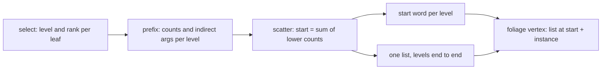

# The foliage's level lists hold only what each level draws

## Goal & Context

fn-257 task 8 (2026-10-16, SPRUCE.md) named the 80.8 MB the spruce's kept tree charged without a label: the foliage's level lists (60.4 MB), which give every detail level room for every leaf, and their selection scratch (20.4 MB), both read every frame. Laid end to end, the levels would hold about 15 MB. The owner (2026-10-16): "if we can compress it further even better"; compact layouts are defined where the data is made, not converted at the end.

Measured on this branch's base (0a6664741, `the_drawing_s_memory`, seed 1, `raw/before/memory.txt`): the level lists are 60.4 MB of the spruce's 181.0 MB kept tree, 38.4 of Laurelin's 134.3, 16.5 of Telperion's 108.6, 2.8 of the birch's 15.0, 1.4 of the oak's 13.6.

## Architecture & Data Models

Each frame the selection puts every leaf in exactly one bucket: one of the detail levels, or unseen. So all levels' lists together hold at most the crown's leaf count, whatever the camera. Today each level's list is `align(leaves × 4 B)` and the draws bind level *k* at the fixed dynamic offset `k × stride`; the per-level counts exist only on the device, after the frame's prefix pass.

The new layout: one list of `leaves` words, the levels laid end to end in level order; level *k* starts at the sum of the counts of levels below it. The scatter pass, which already reads the frame's final counts, writes each leaf at its level's start plus its offset, and writes each level's start word into a small start buffer whose slots sit at the device's storage offset alignment. The draws bind the start buffer at that slot's dynamic offset and the foliage vertex shader reads `list[start + instance_index]`. The order within a level is unchanged, so each level draws the same leaves in the same order as before.



## Acceptance Criteria

- **R1:** each detail level's list is sized from what it can hold and the levels laid end to end in one buffer (or the selection scratch shared where lifetimes allow), written in that layout where they are made; the foliage draws read the new layout on the device; the CPU path unchanged. Errors: a crown with no leaves or no levels keeps today's early out; a level with no leaves this frame draws nothing and its start equals the next level's; a forced level puts every seen leaf in that level from start 0; more than 65,535 workgroups still fold into rows; the 16-level ceiling and the device's limits are judged by name before upload (`submit::fits`), as now.
- **R2:** every preset's kept-tree memory before and after, labelled; frame time whole and close not worse; stills of every preset at its preset age unchanged to the eye, and the drawn leaves byte-identical per frame where the view is fixed. Errors: no error surface; a still that differs in any pixel is reported with its preset and view.
- **R3:** gate and npm test green; codex review. Errors: no error surface beyond the gate's.

## Early proof point

Task fn-292-the-foliages-level-lists-hold-only-what.1 validates the core approach (the per-level lists read back from the end-to-end layout equal the old layout's, level by level, and the stills are byte-identical). If it fails, re-evaluate how the start reaches the draw (a dynamic offset on a start buffer) before continuing with fn-292-the-foliages-level-lists-hold-only-what.2.

## Boundaries

- Release item (fn-237), after fn-257 (fn-257's code is on this release branch; its open completion review is the oak's speed, which this spec does not touch).
- The selection scratch stays as it is: its per-leaf ranks are read by the scatter in the same dispatch that writes the lists, so the two cannot share memory; it is reported with its size.
- No indirect first instance (not in WebGPU's core); no change to which leaves a level selects (fn-176's pruning is its own spec).
- The CPU path (the core's tree and `Delivery::Cpu`) never touches the selection and is unchanged.

## Strategy Alignment

Active tracks served by this plan:
- **Surface and rendering at scale** — the largest kept buffer of the biggest trees shrinks to the leaves it can hold, for every tree through the one renderer.

## Decision Context

- A start buffer bound at a per-level dynamic offset, written by the scatter, over the alternatives: a fourth dispatch only to sum the counts (one more launch a frame for the same 16 additions), or the vertex shader summing the counts itself (another storage binding in the vertex stage and 16 reads per vertex).
- Sharing the scratch with the lists was weighed and dropped (Boundaries).

## Quick commands

```bash
cargo test --profile ci -p telperion-render --lib select
cargo test --profile ci -p telperion-render --test submit
```

## Requirement coverage

| Req | Description | Task(s) | Gap justification |
| --- | --- | --- | --- |
| R1 | each detail level's list is sized from what it can hold and the levels laid end to end in one buffer (or the selection scratch shared where lifetimes allow), written in that layout where they are made; the foliage draws read the new layout on the device; the CPU path unchanged. Errors: a crown with no leaves or no levels keeps today's early out; a level with no leaves this frame draws nothing and its start equals the next level's; a forced level puts every seen leaf in that level from start 0; more than 65,535 workgroups still fold into rows; the 16-level ceiling and the device's limits are judged by name before upload (`submit::fits`), as now. | fn-292-the-foliages-level-lists-hold-only-what.1 | — |
| R2 | every preset's kept-tree memory before and after, labelled; frame time whole and close not worse; stills of every preset at its preset age unchanged to the eye, and the drawn leaves byte-identical per frame where the view is fixed. Errors: no error surface; a still that differs in any pixel is reported with its preset and view. | fn-292-the-foliages-level-lists-hold-only-what.2 | — |
| R3 | gate and npm test green; codex review. Errors: no error surface beyond the gate's. | fn-292-the-foliages-level-lists-hold-only-what.2 | — |

